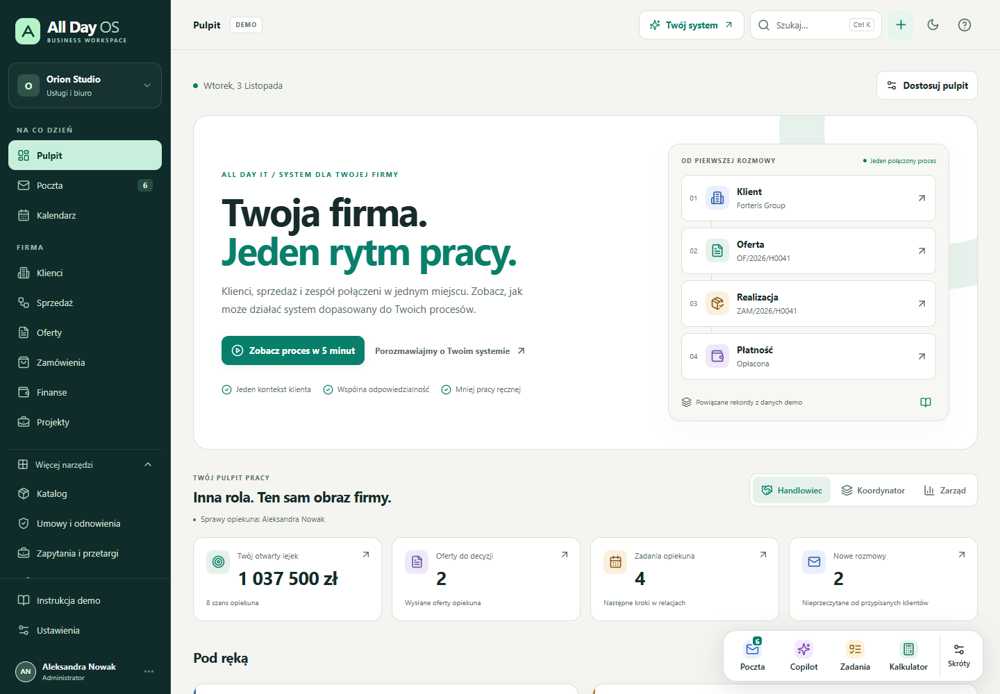
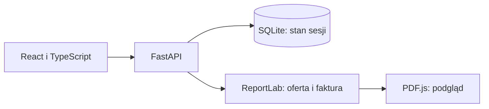

# All Day OS — demo CRM i ERP

A self-contained CRM and ERP demo with a React frontend, FastAPI backend, and per-session SQLite data.

[Otwórz publiczne demo](https://demo.alldayit.pl/)



All Day OS pokazuje, jak mały zespół może przejść od zapytania do rozliczenia w jednej aplikacji. Każdy z trzech scenariuszy — usługi, dystrybucja lub realizacja projektów — ma powiązane dane demonstracyjne.

## Przejdź proces na przykładzie

1. W **Klienci** otwórz kartę firmy i przejrzyj powiązane wiadomości, zadania i dokumenty.
2. W **Oferty** utwórz wycenę z kilku pozycji i wygeneruj PDF. Kwoty i VAT oblicza serwer.
3. Zaakceptuj ofertę w demo i utwórz zamówienie, potem fakturę. Zarejestruj przykładową płatność i zobacz zmianę salda.
4. Wypróbuj przykłady automatyzacji, kampanii i analizy dokumentów. Historia rejestruje zdarzenia w Twojej sesji.

W demo są też szanse sprzedaży, kalendarz, katalog, odnowienia licencji, projekty, raporty i przewodnik po interfejsie. Poczta, AI i KSeF działają w trybie symulacji. Dane firm, raportów i dokumentów są fikcyjne.

## Architektura



Backend łączy rekordy procesu, oblicza kwoty przy użyciu Decimal i zapisuje zwięzły dziennik operacji. Losowy identyfikator sesji pozostaje w ciasteczku, a serwer przechowuje jego skrót. Reset dotyczy wyłącznie bieżącej sesji.

## Uruchomienie lokalne

Wymagania: Node.js 22.13+, npm oraz Python 3.11+.

```bash
npm ci
npm run build
python -m pip install -r demo/requirements.txt
python -m uvicorn demo.backend:app --host 127.0.0.1 --port 8400
```

Otwórz [localhost:8400](http://127.0.0.1:8400). Żeby pracować nad interfejsem z przeładowaniem kodu, uruchom też `npm run dev` i otwórz port 3400. Vite przekazuje żądania API do portu 8400.

## Weryfikacja

```bash
npm run typecheck
python -m pip install pytest httpx2 pypdf
python -m pytest demo/test_backend.py -q
```

Testy obejmują m.in. izolację sesji, cykl dokumentów sprzedażowych, scenariusze danych i generowanie PDF. Kod interfejsu znajduje się w `demo/ui`, a warstwa aplikacji i dane przykładowe w `demo/backend.py` oraz `demo/data_seed.py`.
